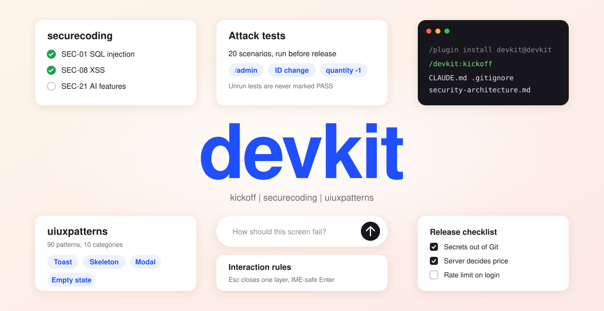
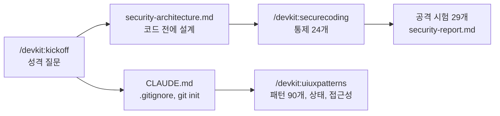

<p align="center">
  
</p>

<h1 align="center">devkit</h1>

<p align="center">
  <b>모든 프로젝트를 같은 세팅으로 시작한다:</b><br>
  <b>프로젝트 킥오프, 보안 설계, UI/UX 패턴.</b>
</p>

<p align="center">
  <a href="CHANGELOG.md"></a>
  <a href="LICENSE"></a>
  <a href="https://code.claude.com"></a>
  <a href="CONTRIBUTING.md"></a>
</p>

<p align="center">
  <a href="#설치">설치</a> | <a href="#스킬">스킬</a> | <a href="#securecoding">securecoding</a> | <a href="CONTRIBUTING.md">기여</a> | <a href="SECURITY.md">보안</a> | <a href="README.md">English</a>
</p>

[Claude Code](https://code.claude.com) 용 스킬. MIT, 제3자 출처는 [NOTICE.md](NOTICE.md). 스킬 본문은 한국어이고 영어 번역은 [ROADMAP.md](ROADMAP.md) 에 있다.

<table>
<tr>
<td align="center"><b>3</b><br>스킬</td>
<td align="center"><b>24</b><br>보안 통제</td>
<td align="center"><b>29</b><br>공격 시험</td>
<td align="center"><b>90</b><br>UI/UX 패턴</td>
<td align="center"><b>69</b><br>KISA 항목 대응</td>
</tr>
</table>

## 왜 필요한가
보안과 화면 규칙은 시작할 때 정하면 싸고 나중에 고치면 비싸다. `devkit` 은 첫 기능 전에 성격 질문, 보안 설계 문서, 고정된 공격 시험, 이름으로 찾아볼 수 있는 패턴 목록을 앞에 둔다.

## 동작 순서


## 써 보기
| 이렇게 말한다 | 스킬 |
|---|---|
| "새 프로젝트 세팅해 줘" | `kickoff` |
| "이 로그인 코드 보안 검토해 줘" | `securecoding` |
| "이 폼에 빈 화면, 오류, 로딩 상태가 있나?" | `uiuxpatterns` |
| "결제 실패는 토스트야 모달이야?" | `uiuxpatterns` |

## 설치
```text
/plugin marketplace add muramasaDev/devkit
/plugin install devkit@devkit
```
플러그인 없이 쓰려면 `skills/` 의 세 폴더를 모두 `~/.claude/skills/` 에 복사한다 (`kickoff` 가 `securecoding` 의 템플릿을 읽는다). 스킬은 `SKILL.md`, `references/`, `templates/` 로 이루어진다.

## 스킬
| 스킬 | 호출 | 용도 |
|---|---|---|
| `kickoff` | `/devkit:kickoff` | 새 프로젝트 세팅: 성격 질문, `CLAUDE.md`, `.gitignore`, `git init`, 보안 설계 문서, 적용할 스킬 안내 |
| `securecoding` | `/devkit:securecoding` | 보안 설계 및 검수: 통제 24개, 공격 시험 29개, 보고 양식 |
| `uiuxpatterns` | `/devkit:uiuxpatterns` | UI/UX: 패턴 90개, 확장 용어 69개 및 UX 법칙, 웹 플랫폼 기능 선택표, 상호작용 규칙, 에이전트 화면 기준, 접근성 및 다크 패턴 점검 |

작업이 스킬 설명과 맞으면 자동으로도 불러온다.

## securecoding
- **설계 먼저**: 요청 경로 (입구 계층, 서비스 계층, 데이터 계층), 원칙 16개, 첫 기능 전에 채우는 `security-architecture.md`
- **통제 24개 (SEC-01 ~ SEC-24)**: SQL 인젝션, 무차별 대입, 비밀번호 해시, 파일 업로드, 의존성, 인증 및 MFA 및 인증번호, 권한 (IDOR), XSS, CSRF, 세션, 전송, 비밀정보, API 입력, 설정, 로그, 공급망, 인프라, 시험, 비즈니스 로직과 결제, 필드 허용 목록 (mass assignment), AI 기능 (프롬프트 인젝션), SQL 외 인젝션, 암호, 언어 한정
- **공격 시험 29개**: `/admin`, ID 바꾸기, 브라우저의 키, 가격 변조, 수량 -1, 결제 위조, 쿠폰 반복, 가입 시 관리자, 인증번호 대입, '지시 무시해', 닉네임 스크립트, 가짜 이미지 업로드, Git 의 `.env`, DB 직접 쿼리 등
- **참조**: KISA 소프트웨어 개발보안 가이드 (2021.12.29) 대응표, 근거 등급을 붙인 사고 사례, Cloudflare 및 AWS 및 Oracle Cloud 규칙
- 규칙마다 근거를 표시한다: `[원문]` 원문 페이지 확인, `[요약 확인]` 가져온 요약본으로 확인, `[KISA]` 가이드 확인, `[일반]` 미확인, `[미실행]` 명령 미실행. 실행하지 않은 시험은 PASS 로 적지 않는다

## 구성
```text
.claude-plugin/   plugin.json, marketplace.json
skills/
  kickoff/        SKILL.md, templates/, references/
  securecoding/   SKILL.md, references/, templates/
  uiuxpatterns/   SKILL.md, references/, templates/
scripts/          validate_uiuxpatterns.py
assets/           banner.svg, social-preview.png
```

## 한계
- 체크리스트 및 설계 지침이며 침투시험과 법률 자문이 아니다
- 수치는 각 파일에 적은 날짜의 출처 문서 기준이다. 계약과 감사에 인용하기 전에 출처에서 다시 확인한다
- `uiuxpatterns` 입력 폼 9개 카드 장면은 눈으로 대조하지 않았다

## 기여, 보안, 라이선스
- [CONTRIBUTING.md](CONTRIBUTING.md)  |  [SECURITY.md](SECURITY.md)  |  [CHANGELOG.md](CHANGELOG.md)  |  [ROADMAP.md](ROADMAP.md)
- 코드와 스킬 본문은 MIT. `skills/securecoding/references/{controls,architecture,attack-tests}.md` 는 OWASP Cheat Sheet Series 를 가공한 것으로 CC BY-SA 4.0. 상세는 [NOTICE.md](NOTICE.md)
