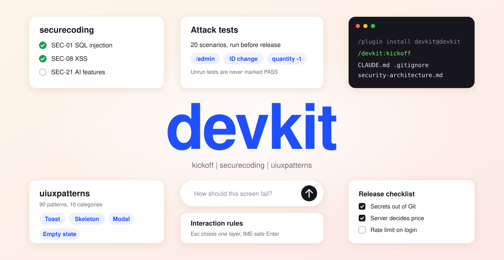

<p align="center">
  
</p>

<h1 align="center">devkit</h1>

<p align="center">
  <b>Start every project with the same setup:</b><br>
  <b>project kickoff, security design and UI/UX patterns.</b>
</p>

<p align="center">
  <a href="CHANGELOG.md"></a>
  <a href="LICENSE"></a>
  <a href="https://code.claude.com"></a>
  <a href="CONTRIBUTING.md"></a>
</p>

<p align="center">
  <a href="#install">Install</a> | <a href="#skills">Skills</a> | <a href="#securecoding">securecoding</a> | <a href="CONTRIBUTING.md">Contributing</a> | <a href="SECURITY.md">Security</a> | <a href="README.ko.md">한국어</a>
</p>

Skills for [Claude Code](https://code.claude.com). MIT, third-party sources in [NOTICE.md](NOTICE.md).

## Install
```text
/plugin marketplace add muramasaDev/devkit
/plugin install devkit@devkit
```
Without the plugin system: copy a folder from `skills/` to `~/.claude/skills/`. Each skill is a plain `SKILL.md` with `references/` and `templates/`.

## Skills
| Skill | Call | Use |
|---|---|---|
| `kickoff` | `/devkit:kickoff` | New project setup: profile questions, `CLAUDE.md`, `.gitignore`, `git init`, security design doc, which skills apply |
| `securecoding` | `/devkit:securecoding` | Security design and review: 24 controls, 20 attack tests, report template |
| `uiuxpatterns` | `/devkit:uiuxpatterns` | UI/UX: 90 patterns, 100+ extended terms and UX laws, native web feature table, interaction rules, agent screen guide, accessibility and dark-pattern checks |

Skills also load automatically when a task matches their description.

## securecoding
- **Design first**: request path (entry layer, service layer, data layer), 16 principles, `security-architecture.md` template to fill before the first feature
- **24 controls (SEC-01 ~ SEC-24)**: SQL injection, brute force, password hashing, file upload, dependencies, auth/MFA/OTP, authorization (IDOR), XSS, CSRF, sessions, transport, secrets, API input, config, logging, supply chain, infrastructure, tests, business logic and payment, field allowlist (mass assignment), AI features (prompt injection), other injections, cryptography, language-specific
- **20 attack tests**: `/admin`, changing IDs, keys in the browser, tampered prices, negative quantity, forged payment, coupon replay, admin signup, OTP guessing, "ignore instructions", script in a nickname, fake image upload, `.env` in Git, direct DB queries, and more
- **References**: KISA Secure Software Development Guide (2021.12.29) mapping, incident cases with evidence grades, Cloudflare / AWS / Oracle Cloud rules
- Every rule is tagged by evidence: `[원문]` OWASP read, `[KISA]` guide read, `[일반]` common practice not verified. Unrun tests are never marked PASS

## Layout
```text
.claude-plugin/   plugin.json, marketplace.json
skills/
  kickoff/        SKILL.md, templates/, references/
  securecoding/   SKILL.md, references/, templates/
  uiuxpatterns/   SKILL.md, references/, templates/
scripts/          validate_uiuxpatterns.py
```

## Language
Skill bodies and references are written in Korean. English README and translations are welcome ([CONTRIBUTING.md](CONTRIBUTING.md)).

## Limits
- A checklist and design guide, not a penetration test or legal advice
- Figures come from the cited documents on the date written in each file. Verify before quoting in contracts or audits
- `uiuxpatterns`: 9 form card scenes are not matched visually

## Contributing, security, license
- [CONTRIBUTING.md](CONTRIBUTING.md)  |  [SECURITY.md](SECURITY.md)  |  [CHANGELOG.md](CHANGELOG.md)
- MIT for code and skill text. `skills/securecoding/references/{controls,architecture,attack-tests}.md` are adapted from OWASP Cheat Sheet Series and licensed CC BY-SA 4.0. Details in [NOTICE.md](NOTICE.md)
